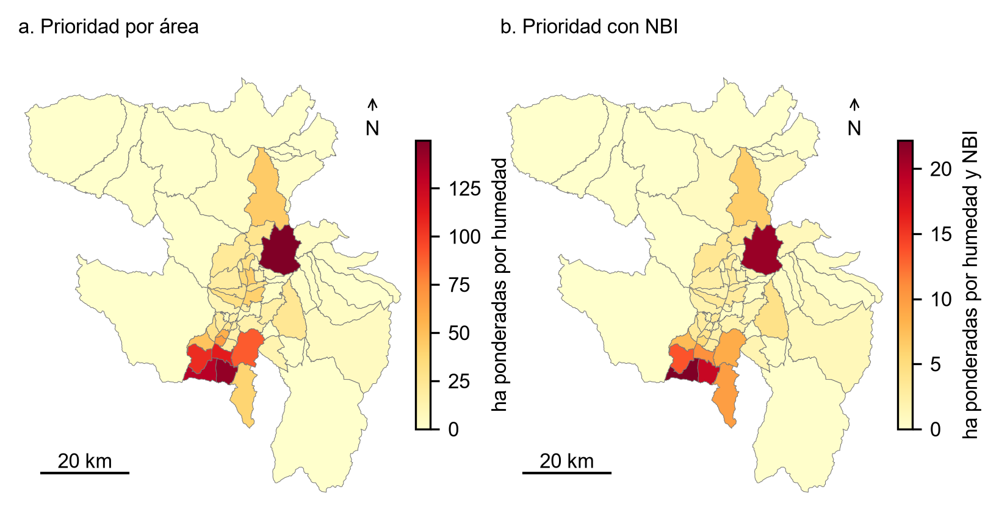

# Quito: susceptibilidad a inundación y prioridad social bajo escenarios de lluvia

**Autor del código: Wilson Gustavo Morales Lastra.** Investigador independiente, Quito, Ecuador.
ORCID: [0009-0008-3413-3705](https://orcid.org/0009-0008-3413-3705).
Contacto: wilogus9@gmail.com.

Paquete de replicación de una red neuronal residual propia de intensidad relativa
de reportes de inundación en Quito, integrada con NBI, saneamiento, agua y
hacinamiento del censo 2022. Conserva escenarios de lluvia estacional, incluida
una alternativa NMME. Corte de fuentes y decisiones: **2026-10-09**. Versión 1.1.0.

Artículo asociado: **Pobreza y priorización ante inundaciones en Quito**, de
Wilson Gustavo Morales Lastra y Josseline Daniela Chavez Carpio, investigadores
independientes, Quito, Ecuador. Contacto de la coautora: chavezdan82@gmail.com;
ORCID [0009-0003-4708-9719](https://orcid.org/0009-0003-4708-9719).
`AUTORES_ARTICULO.json` distingue sus contribuciones al artículo de la autoría
del código. Este repositorio no afirma aceptación ni publicación en una revista.

La contribución es hacer reproducible una priorización multiescala: terreno y
cobertura, susceptibilidad evaluada fuera de entrenamiento, pronóstico de lluvia
en su escala meteorológica y contexto social parroquial. El modelo de Quito es
propio; **no es la red SAR de Microsoft ni una réplica de ese entrenamiento**.

## Ejecutar todo

La versión 1.1.0 añade el [proyecto QGIS y visor 3D](atlas_3d/README.md), sin
cambiar datos, pesos ni estimaciones. Para reproducir los resultados y preparar
el atlas con una sola ejecución, instale las dependencias indicadas abajo y ejecute:

```bash
python EJECUTAR_CON_3D.py
```

Con `--abrir` también se abre el visor local al terminar. Las capas grandes se
reúnen automáticamente desde partes incluidas en el repositorio, con control
SHA-256. El atlas tiene un manifiesto propio, separado del paquete estadístico.
La edición pública excluye las redes municipales originales y los puntos
originales de reportes; conserva los resultados derivados y la exploración de
relieve, susceptibilidad, lluvia y condiciones sociales.

Requiere Python 3.10 o posterior y aproximadamente 1 GB de memoria disponible.
Desde una copia completa del repositorio:

```bash
python -m pip install -r requirements.txt
python reproducir.py
```

En Windows también se puede abrir `EJECUTAR_TODO.cmd`, después de instalar las
dependencias. No se necesita tarjeta gráfica, cuenta NASA, Earth Engine, GitHub
ni conexión de red para ejecutar los datos congelados. La instalación inicial
de NumPy sí requiere una instalación previa o acceso al registro de paquetes.

La ejecución verifica SHA-256, realiza siete controles técnicos, reproduce 48
comparaciones de modelos y 24 diferencias emparejadas, aplica los pesos a
2993619 píxeles construidos y reconstruye seis escenarios para 65 parroquias.
Escribe tablas CSV, scores NumPy, GeoJSON y `VERIFICACION.json` en `resultados/`.

```bash
python reproducir.py --solo-benchmark
python -m pip install rasterio
python reproducir.py --geotiff
python -m pip install -r requirements-entrenamiento.txt
python reproducir.py --solo-benchmark --reentrenar --key temporal__vias_fabdem --device cpu
```

`--geotiff` genera log-densidades con nodata fuera del construido válido.
Los GeoTIFF de referencia contienen percentiles, no las mismas unidades.
El reentrenamiento conserva anclas y particiones, estima seis redes y selecciona
la cota usando calibración, sin modificar los pesos ni los resultados publicados.
`--device cuda` es opcional, con una instalación PyTorch compatible. No se promete
igualdad bit a bit entre sistemas o versiones de PyTorch.

## Qué se reproduce y qué no

| Componente | Reproducción incluida |
| --- | --- |
| Red residual | Inferencia desde pesos numéricos seguros y reentrenamiento opcional sobre anclas congeladas |
| Comparadores loglineal y red libre anteriores | Evaluación desde predicciones congeladas; sus scripts históricos están documentados aparte |
| Mapa de Quito | Inferencia de todos los píxeles construidos con covariables incluidas, no interpolación de muestras |
| Prioridad NBI y servicios | Intersecciones, índices y ordenamientos parroquiales reconstruidos desde píxeles y escenarios |
| Escenarios meteorológicos | Salidas V07 congeladas; esta versión no reajusta ni actualiza el pronóstico estacional |
| Preparación desde imágenes originales | Código histórico y procedencia incluidos; requiere insumos y entornos geoespaciales adicionales |
| ENEMDU económica | No incluida en este paquete geoespacial; no se publican personas, hogares ni celdas económicas pequeñas |

No hay un ganador universal: se publican las cuatro variantes y las dos
particiones. `temporal__vias_fabdem`, B=0.25, es la aplicación territorial
previamente fijada en V12, **no una selección nueva del máximo en test**.
En test temporal esta aplicación captura 0.8676 del soporte de reportes en el
decil territorial superior y tiene log-densidad relativa media 1.963446.
En transferencia espacial sus ganancias son mixtas y no supera uniformemente
al modelo loglineal. Consulte `MODEL_CARD.md` y todas las comparaciones.

## Interpretación



Figura de elaboración propia. Fuentes: WorldCover, FABDEM/Copernicus, reportes
SNGR, cartografía municipal y contexto censal 2022. Es prioridad relativa,
no extensión de una inundación futura. Atribuciones en DATA_LICENSES.md.

La grilla es de 10 m; el relieve tiene soporte nativo de aproximadamente 30 m.
Los objetivos son reportes con incertidumbre posicional, no máscaras completas
de agua. El score es densidad relativa y no probabilidad calibrada de inundación.
El fondo de cuadratura no equivale a ausencia de inundación. La superficie
priorizada no equivale a superficie inundada, población damnificada o pérdidas.
NBI y servicios conservan escala parroquial; no se asignan ingresos a viviendas.
Los escenarios NDJ 2026–2027 no se actualizan al volver a ejecutar este paquete.

## Archivos y documentación

- `reproducir.py`: única entrada, con opciones explicadas.
- `modelo.py`, `entrenar.py`, `pruebas.py`: inferencia, entrenamiento y controles.
- `DATOS_*.npz`, `PIXELES_*.npz`, `PESOS.npz`: matrices derivadas y pesos propios.
- `DATOS_PARROQUIAS.csv`, `DATOS_LLUVIA_ESCENARIOS.csv`: contexto censal y meteorológico.
- `REFERENCIA_*`: resultados congelados para contrastar la reproducción.
- `MANIFEST.json`, `DICCIONARIO_DATOS.md`, `METODOLOGIA.md`: integridad, variables y diseño.
- `AUTHENTICATION.md`, `SECURITY.md`: solicitudes, credenciales y publicación segura.
- `DATA_LICENSES.md`: atribución y restricciones por fuente. **Código MIT; los datos no son todos MIT.**
- `CITATION.cff`, `referencias.bib`: cómo citar este trabajo y sus antecedentes.
- `CODIGO_HISTORICO.zip`: código científico de las ramas usadas, preservado para auditoría.

La organización toma como ejemplo el [paquete de replicación de Canavire-Bacarreza,
Puerta-Cuartas y Ramos](https://github.com/anramosr/Canavire-Puerta-Ramos-2026-WorldDevelopment-Ecuador).
No copia ni redistribuye sus datos o resultados como propios. Este repositorio
no implica validación externa completada ni garantiza aceptación en una revista.

## Citar y contribuir

Morales Lastra, W. G. (2026). *Quito: susceptibilidad a inundación y prioridad
social bajo escenarios de lluvia* (versión 1.0.0) [Software y datos derivados].
Use el archivo `CITATION.cff` y cite también las fuentes utilizadas.
No hay DOI propio asignado en esta versión. Reporte incidencias reproducibles sin
adjuntar credenciales ni microdatos; identifique versión, comando y mensaje.
